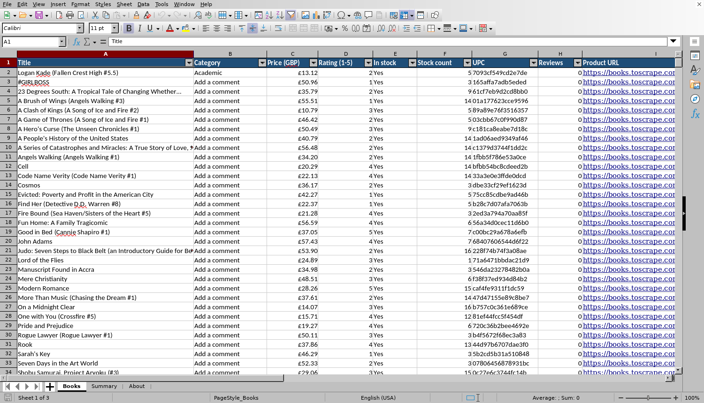
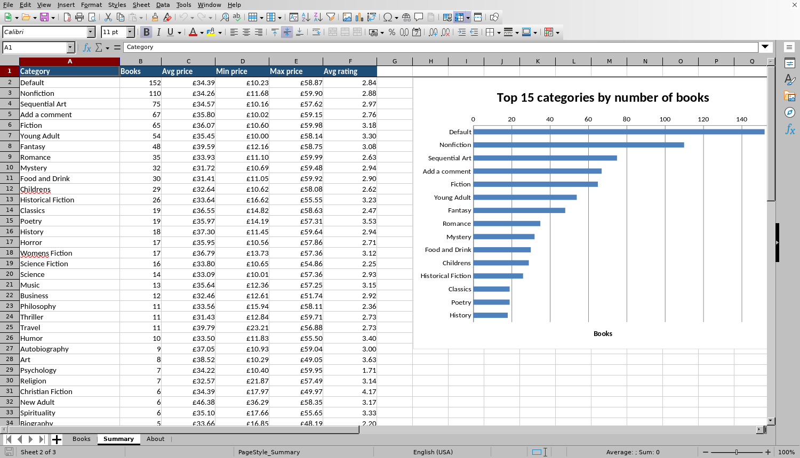

# Web-to-Excel scraper

**A polite, tested Python scraper that turns a website's product catalogue into a client-ready Excel report, with CSV and JSON exports too.**

[](https://github.com/ritanjay/web-to-excel-scraper/actions/workflows/ci.yml)
[](https://github.com/ritanjay/web-to-excel-scraper/actions/workflows/scrape.yml)

The demo target is [books.toscrape.com](https://books.toscrape.com/), a sandbox site built for scraping practice. The structure carries over directly to real jobs like competitor price tracking, product catalogues, directories and job boards.





## What you get

One command produces a workbook with three sheets:

| Sheet | Contents |
|---|---|
| **Books** | One row per product: title, category, price (£ format), rating, stock, links. Formatted as an Excel table with filter/sort buttons and a frozen header. |
| **Summary** | Per-category count, average/min/max price and average rating, as **live formulas** that update if you edit the data, sorted biggest-first, plus a chart of the top 15. |
| **About** | Source URL, scrape time, filters used, row counts. |

The latest full scrape (1,000 books in 50 categories, with product details) is in [`sample-output/`](sample-output/): [books.xlsx](sample-output/books.xlsx), [books.csv](sample-output/books.csv), [books.json](sample-output/books.json). It's refreshed every Monday by a [GitHub Actions workflow](.github/workflows/scrape.yml), which shows how a client could get an updated sheet on a schedule without running anything.

## Quick start

```bash
pip install -r requirements.txt        # requests, beautifulsoup4, openpyxl
python -m bookscraper -o books.xlsx    # whole catalogue in under a minute
```

Or install it as a command with `pip install .`, then run `bookscraper ...`.

### Examples

```bash
# Two categories, with UPC / stock count / description from each product page
bookscraper -c Travel -c Poetry --details -o picks.xlsx

# 4+ star books under £20 that are in stock, as Excel and CSV
bookscraper --min-rating 4 --max-price 20 --in-stock -o bargains.xlsx --csv bargains.csv

# Quick test run: first 3 listing pages, cache pages so re-runs are instant
bookscraper --max-pages 3 --cache .cache -o quick-test.xlsx
```

Progress is printed as it runs:

```text
$ bookscraper --details --delay 0.3 -o books.xlsx --csv books.csv
Travel: page 1/1, 11 books so far
Mystery: page 1/2, 31 books so far
Mystery: page 2/2, 43 books so far
Historical Fiction: page 1/2, 63 books so far
...
Details: 975/1000
Details: 1000/1000

Done: 1000 books from 80 pages in 325.1s (1082 requests, 0 from cache)
  wrote books.xlsx
  wrote books.csv
```

(That's the real output of the scheduled run on GitHub Actions. Without `--details` it's about 80 requests and well under a minute.)

## Built to be a good citizen (and reliable)

- **robots.txt** is checked before every new host; disallowed URLs are refused and `Crawl-delay` is honoured
- **Rate limiting**: a configurable pause between requests (`--delay`, default 0.5 s), one request at a time
- **Retries** with exponential backoff on timeouts, connection resets, `429` and `5xx`, while real errors like `404` fail fast
- **Identifies itself** with a descriptive User-Agent
- **Disk cache** (`--cache DIR`) so development and re-runs don't hit the site again
- **Partial failures don't lose data**: a broken page is logged and skipped, everything else is still exported, and the exit code tells a scheduler something went wrong
- **Encoding-safe**: handles pages served without a charset (the classic `£` mojibake) and writes CSV with a BOM so Excel on Windows shows `£` correctly

## Tests

```bash
pip install -e ".[dev]"
pytest              # 35 offline tests using saved HTML fixtures (no network)
pytest -m live      # smoke test against the real site
ruff check .
```

The suite covers parsing edge cases, robots.txt, rate limiting, retry/backoff (with a fake clock, so it runs instantly), caching, filters, pagination, partial failures, the CLI, and the Excel output itself. One test recalculates the workbook in LibreOffice to check the summary formulas give the right numbers. CI runs on Linux and Windows with Python 3.9 and 3.12, plus a live check that the selectors still match the website.

## Project layout

```text
bookscraper/
  fetch.py    polite HTTP: robots.txt, delay, retries, cache
  parse.py    pure HTML -> data functions (easy to adapt to another site)
  scrape.py   crawl order, pagination, filters, optional detail pages
  export.py   Excel (table, formats, formulas, chart), CSV, JSON
  cli.py      command-line interface
tests/        pytest suite + HTML fixtures
.github/workflows/
  ci.yml      lint + tests on Linux/Windows, live smoke test
  scrape.yml  scheduled full scrape that commits fresh data
```

## Adapting it to another site

1. Save one listing page and one detail page into `tests/fixtures/`.
2. Update the CSS selectors in `parse.py` and write tests against the fixtures first.
3. Adjust the crawl order in `scrape.py` (categories → pages → items).
4. Rename columns in `models.py` / `export.py`.

Always check the target site's terms of service and robots.txt, and scrape only public data at a gentle rate.

## License

MIT, see [LICENSE](LICENSE).
